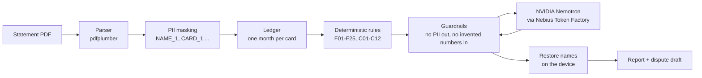

# MollyAI - privacy-first credit card statement audit

**Find what's wrong in your credit card bill - every charge recalculated, compared with your past months, explained in
plain English, and your identity never reaches the AI.**

- Live demo: `<LIVE_DEMO_LINK>`
- Video demo (YouTube): `<YOUTUBE_LINK>`

## 1. The problem

- `[add figure]` - how many card statements contain billing errors (wrong fees, interest, duplicate charges).
- `[add figure]` - how much money cardholders lose to charges they never question.
- `[add figure]` - how few people read or check their statement line by line.
- Checking a statement means re-doing interest, late-fee slabs, GST, forex markup and EMI schedules by hand, and
  remembering what last month looked like - nobody does that.

Market research: [`docs/`](docs/) (market research report PDF).

## 2. What it does

1. **Upload** a statement PDF (password-protected PDFs work) **or pick one of 15 sample statements**.
2. **Audit**: every fee, interest charge, EMI, refund and total is recalculated with exact formulas from the card's
   rulebook and compared with the card's earlier months.
3. **Flags with evidence**: each problem shows expected vs. on-statement amount, how it was calculated and the
   statement lines behind it.
4. **Plain-English explanation** by NVIDIA Nemotron, plus a **conclusion**: what went wrong, how much you were
   overcharged, what you should actually owe and what to address.
5. **Dispute draft** with the facts, the dispute deadline and where to raise it - ready to copy.

## 3. How it works



**Code decides, the LLM explains.** Every amount and every alert comes from deterministic Python
(`cc_audit/checks.py`, `cc_audit/calculators.py`) driven by `config/rulebook.json`. The LLM only explains facts it
is given, checks each alert against the rule text, summarises the month, answers questions and drafts disputes. Its
replies are rejected and replaced by a template if they contain PII or any amount that is not in the data it was sent.
Details: [`docs/ARCHITECTURE.txt`](docs/ARCHITECTURE.txt).

## 4. NVIDIA + Nebius

- **Model**: `nvidia/nemotron-3-super-120b-a12b` (NVIDIA Nemotron 3 Super), set in `config/settings.json`.
  An alternative profile uses `nvidia/NVIDIA-Nemotron-3-Nano-30B-A3B`.
- **Called at runtime** through **Nebius Token Factory**'s OpenAI-compatible endpoint
  (`https://api.tokenfactory.nebius.com/v1`, `/chat/completions`), key from the `NEBIUS_API_KEY` environment variable.
  Reasoning is switched off and replies are capped at 1024 tokens.
- **What each call does** (`cc_audit/explainer.py`):

  | Call | When | What Nemotron does |
  |---|---|---|
  | `review_finding` | once per alert | checks the alert against the rulebook text (verdict agree / disagree / unsure) and explains it |
  | `summarize_month` | once per statement | plain-language note on the alerts and what to do |
  | `answer_question` | when the user asks | answers from the statement's facts, citing evidence |
  | `draft_dispute` | when the user drafts a dispute | writes the subject and body; facts and deadline come from code |

- **Cost**: auditing all 15 sample statements took 27 Nemotron calls (12 alert reviews + 15 summaries). From the logged
  payload sizes (about 83k characters sent, 8k received) and Nebius's listed price of $0.30 / $0.90 per 1M
  input / output tokens, that is roughly **$0.01 for all 15, under $0.001 per statement** (estimate; the log does not
  record exact token counts).

## 5. Privacy

- Names, card numbers, address, phone, email, customer ID and PAN are replaced by tokens (`NAME_1`, `CARD_1` ...)
  **before any LLM call**; the token map stays on the server (`cc_audit/masking.py`).
- Every outgoing payload is scanned for real PII values and PII patterns; if anything is found the call is not made
  (`cc_audit/guardrails.py`). Every call is logged with the exact masked payload.
- Password-protected PDFs are decrypted **in memory**; the password is never stored or logged, and no unlocked copy
  is written. Uploaded PDFs are deleted right after parsing.
- In the web app each visitor gets a private temporary folder; no visitor can see another's statements.

## 6. Results

Latest evaluation on the 15 sample statements ([`docs/evaluation_report.md`](docs/evaluation_report.md)):

| Metric | Result |
|---|---|
| Planted errors caught | **12 / 12** (precision 100%, recall 100%) |
| False alarms | **0** (0 of 5 clean statements raised an alert) |
| Extracted fields correct | **1277 / 1277** |
| Masking recall | **30 / 30** planted PII values never reach the ledger, reports or LLM traffic |
| Invented amounts in LLM replies | **0** of 27 calls (AI verdict "agree" on all 12 alerts) |

Stress test ([`docs/error_injection_report.md`](docs/error_injection_report.md)): 100 errors injected into the clean
statements across 17 error types - **100 / 100 caught**, 0 false alarms on the untouched statements.

## 7. For judges

The judge tools are behind a passkey: **the passkey is in the Devpost testing instructions.** Enter it in the
**For judges** strip at the bottom of the page.

- **Sample statements** - "Start here" buttons open statements with planted problems; any of the 15 can be audited
  without uploading anything (results come from a cached live Nemotron run, so no API key is needed).
- **Answer-key view** - on a sample report, the *Compare with answer key* tab shows planted errors caught / missed /
  false alarms; the *All samples scorecard* scores all 15.
- **Error Lab** - plant your own errors in a clean statement (17 one-click presets or free edits) and see whether the
  agent catches them.
- **Custom rules** - write your own rule from templates and test it on the samples or in the Error Lab.
- **Rulebook** - every rule the engine checks (F01-F25, C01-C12, N01-N07), read live from `config/rulebook.json`.

## 8. Run locally

Python 3.10+.

```bash
git clone <this repo> && cd <repo folder>
pip install -r requirements.txt
cp .env.example .env          # then put your own Nebius key in .env (and a judge passkey of your choice)
streamlit run streamlit_app.py
```

Without a key the app still runs every check, and the sample statements still show their cached AI explanations.
On Streamlit Community Cloud, add `NEBIUS_API_KEY` and `JUDGE_PASSKEY` under **Settings -> Secrets**.

Evaluation and stress test:

```bash
python audit.py run all_15_statements --no-llm     # parse, mask and audit the 15 samples into data/
python tools/evaluate.py                           # score against the answer key
python tools/evaluate_report.py --key answer_key_DO_NOT_SHARE_WITH_ENGINE.xlsx --data data/ --out eval_out/
python tools/error_injection_test.py --n 100 --seed 42 --out eval_out/
pip install pytest && python -m pytest tests/
```

Drop `--no-llm` to include the Nemotron calls (needs `NEBIUS_API_KEY`). `python tools/build_sample_cache.py`
rebuilds the cached sample reports. The answer key is read only by the evaluators and the judge view; a test checks that
the audit engine (`cc_audit/`) never reads it.

## 9. Disclaimer

> **Demo rulebook - for hackathon evaluation only.** These rules are our own interpretation of a sample card's Most
> Important Terms & Conditions (MITC), built to test this project on dummy statements. They are not an official bank
> policy, may be incomplete or outdated, and are not financial or legal advice. Please do not copy, redistribute or rely
> on them for real decisions. Your bank's current MITC is the only authoritative source.

All statements in this repository are synthetic dummy data; the people, card numbers and contact details in them are
made up.

## 10. Tech stack, team, license

- **Stack**: Python, Streamlit, pdfplumber, pypdf, openpyxl, pandas; NVIDIA Nemotron 3 Super on Nebius Token Factory.
- **Team**: Mouli Saraf, Jayesh.
- **License**: [MIT](LICENSE).
